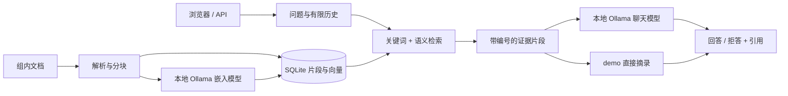

# 研知 LabKB

面向课题组的本地知识库问答框架：把组内说明、仪器操作文档和常见问题整理成可检索的资料，让新人获得带出处的回答，也让硬件采购有可复现的评测依据。

**先跑通资料 → 检索 → 回答 → 核对出处，再决定买什么机器。** 本项目提供浏览器界面、Python API、Ollama 适配、文档导入和评测入口，适合作为可上传 GitHub 的研究原型。

## 能做什么

- 导入 Markdown、TXT、可提取文字的 PDF 和 DOCX，切分并存入本地 SQLite。
- `demo` 模式直接检索、展示资料摘录，不下载或调用语言模型。
- `ollama` 模式使用本地嵌入模型进行语义检索，融合关键词检索，再由本地聊天模型组织回答。
- 展示来源片段；无资料支撑时拒答；携带有长度限制的会话历史。
- 提供共享访问令牌、Docker 配置、测试和评测脚本。

这是**单个共享知识库的原型**，不是已经完成多用户权限、审计、生产容量验证的系统。资料引用不等于事实自动验证；实验操作仍应核对原始 SOP。扫描 PDF 需要先做 OCR，本项目未包含 OCR。

## 五分钟体验：不需要 GPU 或 Ollama

需要 Python 3.11 或更高版本。在项目根目录执行以下命令；首次安装依赖需要联网。

Windows PowerShell：

```powershell
py -3 -m venv .venv
.\.venv\Scripts\python.exe -m pip install -e ".[dev]"
Copy-Item .env.example .env
.\.venv\Scripts\python.exe -m labkb
```

macOS / Linux：

```bash
python3 -m venv .venv
.venv/bin/python -m pip install -e '.[dev]'
cp .env.example .env
.venv/bin/python -m labkb
```

打开 [本地界面](http://127.0.0.1:8000)，点击“加载示例资料”，再点击示例问题或自行提问。也可以手动上传 `src/labkb/samples/` 中的虚构文档。界面中的 demo 回答是资料摘录，**不能用来评估大模型回答质量或 GPU 推理速度**。五分钟是代码和网络已准备好的体验目标，不包含首次依赖下载时间。

CLI 默认只监听 `127.0.0.1:8000`；停止服务按 `Ctrl+C`。CLI 会读取项目目录的 `.env`，已经设置的进程环境变量优先。

## 接上本地大模型

1. 从 [Ollama 官方网站](https://ollama.com/download)安装对应系统的软件并启动服务。
2. 下载一组起步用的聊天模型和嵌入模型：

   ```text
   ollama pull qwen3:8b
   ollama pull qwen3-embedding:0.6b
   ```

3. 修改 `.env` 中的以下配置，然后重启 LabKB：

   ```dotenv
   LABKB_MODE=ollama
   LABKB_DATA_DIR=data/ollama
   LABKB_OLLAMA_URL=http://127.0.0.1:11434
   LABKB_CHAT_MODEL=qwen3:8b
   LABKB_EMBED_MODEL=qwen3-embedding:0.6b
   LABKB_NUM_CTX=8192
   ```

4. 手动上传资料，在浏览器提问并核对引用。“加载示例资料”按钮仅用于 demo；真实模式可显式上传 `src/labkb/samples/` 中的示例文档。切换 demo / ollama 或嵌入模型时，使用新的数据目录并重新导入，避免混用不同的索引。

这些模型名是可配置的起步示例，不代表当前最强模型，也不是针对你的硬件做出的性能承诺。模型标签见 [Qwen3 8B](https://ollama.com/library/qwen3:8b) 与 [Qwen3 Embedding](https://ollama.com/library/qwen3-embedding)。嵌入模型负责“找资料”，聊天模型负责“组织回答”；两者可以分别比较。

## 架构



demo 跳过嵌入模型和聊天模型。向量采用 SQLite 保存、应用内遍历计算，便于小规模资料启动；没有实现大型语料的近似向量索引或分布式服务。详见 [架构与边界](docs/architecture.md)。

## 配置

| 变量 | 默认值 | 作用 |
| --- | --- | --- |
| `LABKB_MODE` | `demo` | `demo` 或 `ollama` |
| `LABKB_DATA_DIR` | `data` | 本地资料索引目录，禁止提交到 GitHub |
| `LABKB_OLLAMA_URL` | `http://127.0.0.1:11434` | Ollama 地址 |
| `LABKB_CHAT_MODEL` | `qwen3:8b` | 生成回答的模型 |
| `LABKB_EMBED_MODEL` | `qwen3-embedding:0.6b` | 文档和查询共同使用的嵌入模型 |
| `LABKB_API_TOKEN` | 空 | 共享访问令牌；设置时须至少 24 字符，非回环监听时必填 |
| `LABKB_NUM_CTX` | `8192` | 请求给聊天模型的上下文窗口，至少为 4096 |
| `LABKB_SEMANTIC_THRESHOLD` | `0.55` | 语义召回阈值；应依据真实题库校准，不是正确率 |

`8192` 指 token 上下文预算，不是磁盘存储上限。它需要容纳系统提示、证据、历史和输出；直接调大可能增加内存占用，不能代替正确的历史处理与检索。见 [Ollama 上下文说明](https://docs.ollama.com/context-length)。

## 部署与评测

- [部署指南](docs/deployment.md)：本机运行、Docker、局域网访问和排障。
- [API 说明](docs/api.md)：上传、检索、问答与返回字段。
- [评测指南](docs/evaluation.md)：资料命中、引用正确性、拒答、响应时间和采购验收。
- [硬件调研工作表](docs/hardware.md)：试验档位、实际报价、成本和性能记录；没有编造硬件价格或 token/s。
- [安全与数据边界](SECURITY.md)：共享令牌不等于用户权限，组内资料和密钥不得上传 GitHub。
- [本次验收记录](docs/verification.md)：已经运行的检查与尚未验证的部分。

已启动服务并导入示例资料后，可运行：

```text
python scripts/benchmark.py --base-url http://127.0.0.1:8000 --questions examples/eval.jsonl --output data/benchmark.json
```

在上述虚拟环境中运行时，请将 `python` 替换为该环境中的 Python 路径。启用了令牌时，在运行脚本的进程中设置 `LABKB_API_TOKEN`。基准脚本结果是具体机器、具体资料和配置下的观测，不代表其它模型或硬件。

## 开发与 GitHub

```text
python -m pip install -e ".[dev]"
python -m pytest
python -m ruff check .
```

仓库包含 GitHub Actions 配置，在 Python 3.11 和 3.12 上运行测试和静态检查；工作流需要推送到 GitHub 后才能在 GitHub 执行。准备公开时，仅提交代码、文档和虚构示例；核对暂存区中没有 `.env`、`data/`、数据库、模型权重及真实组内资料。不要使用不经检查的全目录上传。

需要复用本次依赖版本时，先运行 `python -m pip install -r requirements.lock`，再运行 `python -m pip install -e . --no-deps`。该快照来自 Python 3.12，跨平台仍应运行测试。使用 `python scripts/package_source.py` 生成 `dist/labkb-0.1.0-source.zip`；打包目录只应放公开源码和虚构示例，打包前仍需检查是否误放了内部资料。Windows 已安装环境可运行 `powershell -File scripts/start.ps1`，默认使用 8765 端口。

本项目交付的是可运行原型和评测方法。单文件上限 10 MiB、提取文字上限 50 万字符、PDF 上限 300 页、全库上限 5000 个片段；服务采用单进程串行保护，不能通过增加 workers 扩容。真实 Ollama / GPU、Docker 镜像构建、多人负载和具体硬件配置是否通过验证，以你实际运行的报告为准；没有真实报告就不宣称已经验证。模型与依赖有各自许可证，本仓库代码采用 [MIT](LICENSE)。
